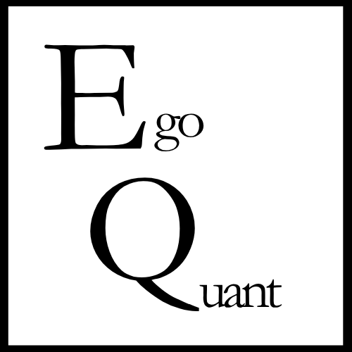
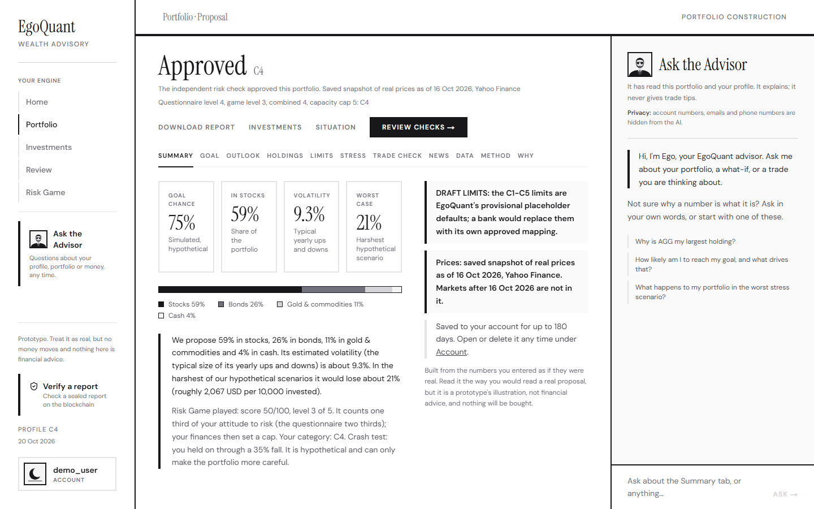

<div align="center">



# EgoQuant

**A wealth-advisory agent you can understand, question and audit.**<br>
Website · 2026 Shenzhen FinTechathon · WeBank International Track · Topic B

<a href="https://www.egoquant.app"></a>
<a href="https://github.com/EgoQuantAI/egoquant-backend"></a>
<a href="https://github.com/EgoQuantAI/egoquant-backend/blob/main/submission/1_Technical_Documentation/00_EgoQuant_Technical_Documentation.pdf"></a>


</div>

---

This is the part of EgoQuant you see in the browser. The engine, the API and all the documents are in **[egoquant-backend](https://github.com/EgoQuantAI/egoquant-backend)**.

Live: **[www.egoquant.app](https://www.egoquant.app)**

> [!NOTE]
> This repository is a snapshot of the version we submitted on 20 October 2026 (tag `submission-20oct`), in one commit. Our day-to-day history stays in a private repository.

<p align="center">
  
</p>

## What is in here

| | |
|---|---|
| **The five steps** | I. Profile (the questionnaire) · II. Risk Game · III. Investments · IV. Portfolio (the report and its tabs, with the advisor beside it) · V. Review |
| **The advisor** | Explains the report in plain words, runs what-if scenarios and checks a planned trade through the engine |
| **Verify a report** | Checks a sealed report against the Sepolia test chain, in your browser, with no account |
| **Account pages** | Saved reports, imported trading history, consents, activity, and deleting your data |
| **No token in the browser** | Sign-in runs through the website's own server routes; the session lives in HttpOnly cookies |
| **Numbers come from the engine** | Every number and sentence about the portfolio comes from the backend; the website lays it out and never changes it |

## Run it on your machine

You need Node.js 22 or newer. Start the backend first ([its README](https://github.com/EgoQuantAI/egoquant-backend#run-it-on-your-machine), one command), then:

```bash
git clone https://github.com/EgoQuantAI/egoquant-frontend.git
cd egoquant-frontend
npm install
cp .env.example .env.local      # BACKEND_URL=http://localhost:8000
npm run dev
```

Open http://localhost:3000. The website needs nothing else: sign-in, saved reports and sealing all go through the backend, so they work exactly as far as the backend is set up (its README says what each key turns on).

| Variable | What it does | Without it |
|---|---|---|
| `BACKEND_URL` | Where the backend runs (`http://localhost:8000` locally). Server-side only: the browser calls this app's own `/api/*` routes, which forward to the backend | The live backend address written in `src/lib/backend.ts` is used |

## Test cases

```bash
npm test                          # automatic tests (node --test, tests/*.test.mjs)
npm run lint                      # ESLint
npx tsc --noEmit -p .             # type check
npm run build                     # the production build
node scripts/check-vectors.mjs    # the in-browser seal code against the backend's test vectors (323 checks)
```

The seal check makes sure the browser computes exactly the same fingerprint as the backend, for every committed proof and for tampered copies. The engine's **3,554 tests**, by area, are in the [backend README](https://github.com/EgoQuantAI/egoquant-backend#test-cases).

## Deploy it

Import the repository into Vercel, set `BACKEND_URL` to the backend's HTTPS address, deploy. The backend and Supabase side: [DEPLOYMENT.md in the backend repository](https://github.com/EgoQuantAI/egoquant-backend/blob/main/DEPLOYMENT.md).

## What is where

<details>
<summary><b>Repository map</b></summary>

| Path | What it is |
|---|---|
| `src/app/` | Pages, and the server routes under `src/app/api/` that talk to the backend |
| `src/components/` | The screens: questionnaire, Risk Game, report tabs, advisor, account, verify |
| `src/lib/` | Server-side auth (`server-auth.ts`), the backend proxy (`backend.ts`), the in-browser seal check (`proof.ts`) |
| `tests/`, `scripts/` | Automatic tests and the seal test-vector check |
| `docs/` | UI decisions and the screenshots used in the documents |
</details>

## Design

Deliberately plain: black, white and greys, serif headings, square edges, red only when something is wrong. The decisions behind the screens are in [`docs/UI_DECISIONS.md`](docs/UI_DECISIONS.md); the screenshots used in the documents are in [`docs/screens/`](docs/screens/).

---

<sub>The long technical README of the development repository: [README_DETAILED.md](README_DETAILED.md).</sub>
